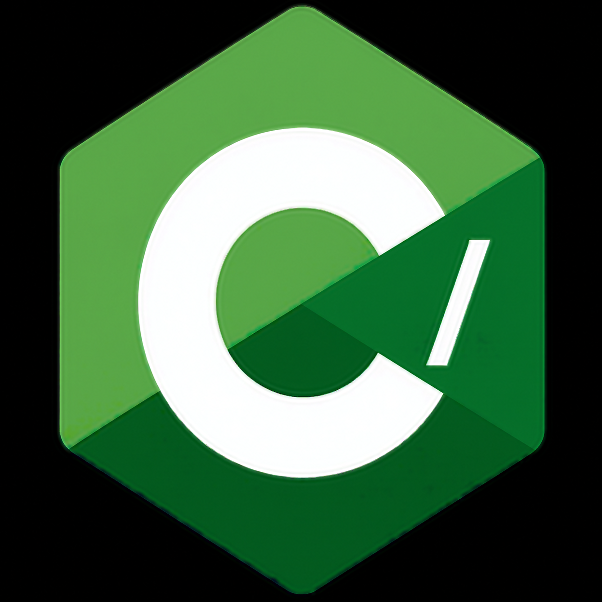

# C/





**C/** (C-slash) is an ultra-fast, minimalist, security-focused orchestration language. It bridges code ecosystems, letting you pull features from web, desktop, and low-level systems code into one unified codebase.

## Highlights


- **Stripped-down native core.** The core language is bare-minimum to preserve raw execution speed.
- **Pluggable metaprogramming.** Features are bootstrapped on the fly. A directive such as `#include: "pr.txt";` at the top of a file can modify the lexer's grammar mid-stream (for example, teaching it to accept single-quote strings).
- **Private Runtime (PR).** A self-hosted version of the C/ Runtime (the full Runtime is not public): a sandboxed execution layer written in C++ with a unified memory pool, on-the-fly type translation, and strict blocking of unauthorized file system and network access.
- **Universal language integration.** Files are checked against a registry of importable languages (see below).

## Importable languages

| Tier | Languages |
|------|-----------|
| Web | JavaScript (`.js`), TypeScript (`.ts`, types stripped by an internal transpiler first) |
| JVM | Java (`.java`, `.class`, `.jar`) |
| Systems | C (`.c`), C++ (`.cpp`, `.hpp`), C# (`.cs`, `.csx`, `.csproj`, `.sln`, `.slnx`) |

## Quick look

```text
#import: "pr.txt";
* // This is a native comment line!
#create: "byte_target.txt", to: dir/default;
from: "pr.cache";

#if: "byte_target.txt" = dir/default/byte_target.txt,
#convert: dir/default/byte_target.txt, to: cslash;

#if dir/default/byte_target.cslash = valid,
#run: "byte_target.cslash", then:
#byte_generate: "logo_test.png"
```

See [SPEC.md](SPEC.md) for the full syntax and [examples/](examples/) for more.

## Status

Early design stage. Syntax and runtime details are subject to change.

## Repository layout

```text
.
├── README.md
├── SPEC.md
├── examples/
│   └── hello.cslash
├── assets/            # logo goes here
├── .gitattributes
└── .gitignore
```
